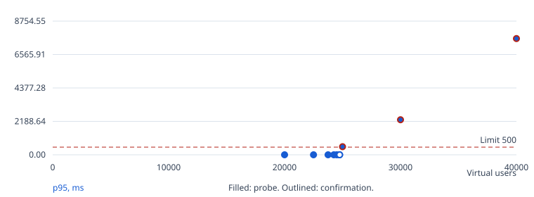
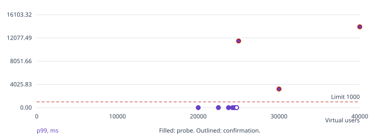
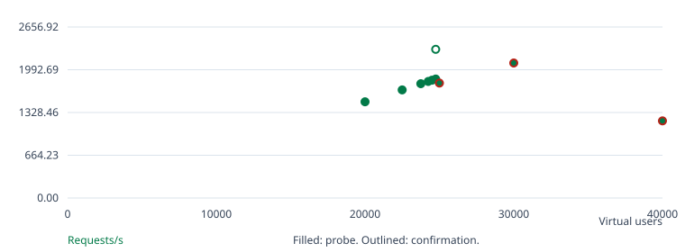
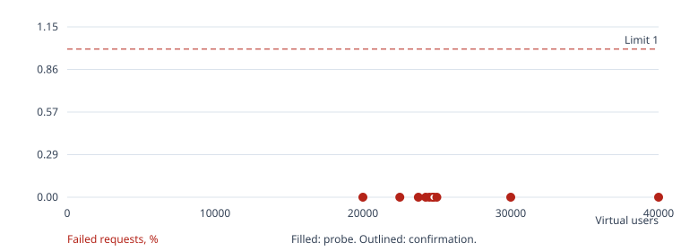

# Go / SQLite benchmark

Confirmed k8s baseline: 24,750 virtual users.

Search status: completed.

Search and confirmation finished.

## Run overview

| Run | Phase | Users | Hold | Result | Requests | Req/s | p95 ms | p99 ms | Errors % | Checks |
| --- | --- | --- | --- | --- | --- | --- | --- | --- | --- | --- |
| 1 | warmup | 1000 | 120s | passed | 18276 | 83.07 | 0.91 | 1.20 | 0.000 | passed |
| 2 | search | 20000 | 60s | passed | 239117 | 1,494.32 | 1.04 | 2.49 | 0.000 | passed |
| 3 | search | 40000 | 60s | threshold failed | 192192 | 1,198.28 | 7,612.65 | 14,002.89 | 0.000 | passed |
| 4 | refine | 30000 | 60s | threshold failed | 336156 | 2,097.57 | 2,293.48 | 3,230.80 | 0.000 | passed |
| 5 | refine | 25000 | 60s | threshold failed | 285817 | 1,785.06 | 528.70 | 11,550.13 | 0.000 | passed |
| 6 | refine | 22500 | 60s | passed | 268898 | 1,680.12 | 1.60 | 5.73 | 0.000 | passed |
| 7 | refine | 23750 | 60s | passed | 284148 | 1,775.34 | 1.13 | 3.51 | 0.000 | passed |
| 8 | refine | 24250 | 60s | passed | 289901 | 1,811.21 | 1.12 | 3.34 | 0.000 | passed |
| 9 | refine | 24500 | 60s | passed | 292857 | 1,829.88 | 1.15 | 3.91 | 0.000 | passed |
| 10 | refine | 24750 | 60s | passed | 295918 | 1,848.89 | 1.17 | 3.97 | 0.000 | passed |
| 11 | confirm | 24750 | 300s | passed | 924267 | 2,310.37 | 1.19 | 4.53 | 0.000 | passed |

## Run 1: warmup, 1,000 users

Outcome: passed. Exit code: 0.

Started: 2026-10-16T22:22:03+00:00. Wall time: 221.14 seconds.

| Condition | Result |
| --- | --- |
| p(95)<500 | passed |
| p(99)<1000 | passed |
| rate<0.01 | passed |
| feed 200 | passed: 8,439 passed, 0 failed |
| post 200 | passed: 8,439 passed, 0 failed |
| like 200/201 | passed: 1,218 passed, 0 failed |
| create 201 | passed: 180 passed, 0 failed |

[Console log](run-001.log)
[Raw k6 summary](k6/run-001.json)
[Structured k6 events](k6/run-001.events.jsonl)
[CPU profile (go tool pprof)](pprof/run-001.cpu.pb.gz)
[Heap profile (go tool pprof)](pprof/run-001.heap.pb.gz)

Average latency: 0.65 ms. Maximum latency: 21.61 ms.

App average CPU: 3.75% of one core. Sampled memory peak: 108.37 MiB. OOM kills: 0. Source: container cgroup CPU, memory.current including page cache, and OOM kills.

## Run 2: search, 20,000 users

Outcome: passed. Exit code: 0.

Started: 2026-10-16T22:26:46+00:00. Wall time: 163.99 seconds.

| Condition | Result |
| --- | --- |
| p(95)<500 | passed |
| p(99)<1000 | passed |
| rate<0.01 | passed |
| feed 200 | passed: 110,241 passed, 0 failed |
| post 200 | passed: 110,241 passed, 0 failed |
| like 200/201 | passed: 16,483 passed, 0 failed |
| create 201 | passed: 2,152 passed, 0 failed |

[Console log](run-002.log)
[Raw k6 summary](k6/run-002.json)
[Structured k6 events](k6/run-002.events.jsonl)
[CPU profile (go tool pprof)](pprof/run-002.cpu.pb.gz)
[Heap profile (go tool pprof)](pprof/run-002.heap.pb.gz)

Average latency: 0.57 ms. Maximum latency: 56.73 ms.

App average CPU: 26.38% of one core. Sampled memory peak: 978.75 MiB. OOM kills: 0. Source: container cgroup CPU, memory.current including page cache, and OOM kills.

## Run 3: search, 40,000 users

Outcome: threshold failed. Exit code: 99.

Started: 2026-10-16T22:30:33+00:00. Wall time: 168.10 seconds.

| Condition | Result |
| --- | --- |
| p(95)<500 | failed |
| p(99)<1000 | failed |
| rate<0.01 | passed |
| feed 200 | passed: 91,661 passed, 0 failed |
| post 200 | passed: 86,551 passed, 0 failed |
| like 200/201 | passed: 11,749 passed, 0 failed |
| create 201 | passed: 1,506 passed, 0 failed |

[Console log](run-003.log)
[Raw k6 summary](k6/run-003.json)
[Structured k6 events](k6/run-003.events.jsonl)
[CPU profile (go tool pprof)](pprof/run-003.cpu.pb.gz)
[Heap profile (go tool pprof)](pprof/run-003.heap.pb.gz)

Average latency: 1,444.91 ms. Maximum latency: 29,398.18 ms.

App average CPU: 63.02% of one core. Sampled memory peak: 1,155.48 MiB. OOM kills: 0. Source: container cgroup CPU, memory.current including page cache, and OOM kills.

## Run 4: refine, 30,000 users

Outcome: threshold failed. Exit code: 99.

Started: 2026-10-16T22:34:26+00:00. Wall time: 177.58 seconds.

| Condition | Result |
| --- | --- |
| p(95)<500 | failed |
| p(99)<1000 | failed |
| rate<0.01 | passed |
| feed 200 | passed: 155,230 passed, 0 failed |
| post 200 | passed: 154,970 passed, 0 failed |
| like 200/201 | passed: 22,748 passed, 0 failed |
| create 201 | passed: 3,022 passed, 0 failed |

[Console log](run-004.log)
[Raw k6 summary](k6/run-004.json)
[Structured k6 events](k6/run-004.events.jsonl)
[CPU profile (go tool pprof)](pprof/run-004.cpu.pb.gz)
[Heap profile (go tool pprof)](pprof/run-004.heap.pb.gz)

Average latency: 329.11 ms. Maximum latency: 9,037.67 ms.

App average CPU: 56.15% of one core. Sampled memory peak: 1,022.04 MiB. OOM kills: 0. Source: container cgroup CPU, memory.current including page cache, and OOM kills.

## Run 5: refine, 25,000 users

Outcome: threshold failed. Exit code: 99.

Started: 2026-10-16T22:38:23+00:00. Wall time: 185.92 seconds.

| Condition | Result |
| --- | --- |
| p(95)<500 | failed |
| p(99)<1000 | failed |
| rate<0.01 | passed |
| feed 200 | passed: 132,684 passed, 0 failed |
| post 200 | passed: 132,684 passed, 0 failed |
| like 200/201 | passed: 18,032 passed, 0 failed |
| create 201 | passed: 2,417 passed, 0 failed |

[Console log](run-005.log)
[Raw k6 summary](k6/run-005.json)
[Structured k6 events](k6/run-005.events.jsonl)
[CPU profile (go tool pprof)](pprof/run-005.cpu.pb.gz)
[Heap profile (go tool pprof)](pprof/run-005.heap.pb.gz)

Average latency: 366.09 ms. Maximum latency: 53,412.69 ms.

App average CPU: 39.60% of one core. Sampled memory peak: 1,061.09 MiB. OOM kills: 0. Source: container cgroup CPU, memory.current including page cache, and OOM kills.

## Run 6: refine, 22,500 users

Outcome: passed. Exit code: 0.

Started: 2026-10-16T22:42:16+00:00. Wall time: 168.38 seconds.

| Condition | Result |
| --- | --- |
| p(95)<500 | passed |
| p(99)<1000 | passed |
| rate<0.01 | passed |
| feed 200 | passed: 124,059 passed, 0 failed |
| post 200 | passed: 124,059 passed, 0 failed |
| like 200/201 | passed: 18,370 passed, 0 failed |
| create 201 | passed: 2,410 passed, 0 failed |

[Console log](run-006.log)
[Raw k6 summary](k6/run-006.json)
[Structured k6 events](k6/run-006.events.jsonl)
[CPU profile (go tool pprof)](pprof/run-006.cpu.pb.gz)
[Heap profile (go tool pprof)](pprof/run-006.heap.pb.gz)

Average latency: 1.12 ms. Maximum latency: 1,329.18 ms.

App average CPU: 29.11% of one core. Sampled memory peak: 1,094.10 MiB. OOM kills: 0. Source: container cgroup CPU, memory.current including page cache, and OOM kills.

## Run 7: refine, 23,750 users

Outcome: passed. Exit code: 0.

Started: 2026-10-16T22:46:07+00:00. Wall time: 163.52 seconds.

| Condition | Result |
| --- | --- |
| p(95)<500 | passed |
| p(99)<1000 | passed |
| rate<0.01 | passed |
| feed 200 | passed: 130,967 passed, 0 failed |
| post 200 | passed: 130,967 passed, 0 failed |
| like 200/201 | passed: 19,588 passed, 0 failed |
| create 201 | passed: 2,626 passed, 0 failed |

[Console log](run-007.log)
[Raw k6 summary](k6/run-007.json)
[Structured k6 events](k6/run-007.events.jsonl)
[CPU profile (go tool pprof)](pprof/run-007.cpu.pb.gz)
[Heap profile (go tool pprof)](pprof/run-007.heap.pb.gz)

Average latency: 0.67 ms. Maximum latency: 311.32 ms.

App average CPU: 30.02% of one core. Sampled memory peak: 1,111.40 MiB. OOM kills: 0. Source: container cgroup CPU, memory.current including page cache, and OOM kills.

## Run 8: refine, 24,250 users

Outcome: passed. Exit code: 0.

Started: 2026-10-16T22:49:53+00:00. Wall time: 163.91 seconds.

| Condition | Result |
| --- | --- |
| p(95)<500 | passed |
| p(99)<1000 | passed |
| rate<0.01 | passed |
| feed 200 | passed: 133,754 passed, 0 failed |
| post 200 | passed: 133,754 passed, 0 failed |
| like 200/201 | passed: 19,767 passed, 0 failed |
| create 201 | passed: 2,626 passed, 0 failed |

[Console log](run-008.log)
[Raw k6 summary](k6/run-008.json)
[Structured k6 events](k6/run-008.events.jsonl)
[CPU profile (go tool pprof)](pprof/run-008.cpu.pb.gz)
[Heap profile (go tool pprof)](pprof/run-008.heap.pb.gz)

Average latency: 0.63 ms. Maximum latency: 71.46 ms.

App average CPU: 30.10% of one core. Sampled memory peak: 1,119.52 MiB. OOM kills: 0. Source: container cgroup CPU, memory.current including page cache, and OOM kills.

## Run 9: refine, 24,500 users

Outcome: passed. Exit code: 0.

Started: 2026-10-16T22:53:40+00:00. Wall time: 163.96 seconds.

| Condition | Result |
| --- | --- |
| p(95)<500 | passed |
| p(99)<1000 | passed |
| rate<0.01 | passed |
| feed 200 | passed: 135,035 passed, 0 failed |
| post 200 | passed: 135,035 passed, 0 failed |
| like 200/201 | passed: 20,081 passed, 0 failed |
| create 201 | passed: 2,706 passed, 0 failed |

[Console log](run-009.log)
[Raw k6 summary](k6/run-009.json)
[Structured k6 events](k6/run-009.events.jsonl)
[CPU profile (go tool pprof)](pprof/run-009.cpu.pb.gz)
[Heap profile (go tool pprof)](pprof/run-009.heap.pb.gz)

Average latency: 0.65 ms. Maximum latency: 61.34 ms.

App average CPU: 30.40% of one core. Sampled memory peak: 1,119.19 MiB. OOM kills: 0. Source: container cgroup CPU, memory.current including page cache, and OOM kills.

## Run 10: refine, 24,750 users

Outcome: passed. Exit code: 0.

Started: 2026-10-16T22:57:26+00:00. Wall time: 164.04 seconds.

| Condition | Result |
| --- | --- |
| p(95)<500 | passed |
| p(99)<1000 | passed |
| rate<0.01 | passed |
| feed 200 | passed: 136,537 passed, 0 failed |
| post 200 | passed: 136,537 passed, 0 failed |
| like 200/201 | passed: 20,172 passed, 0 failed |
| create 201 | passed: 2,672 passed, 0 failed |

[Console log](run-010.log)
[Raw k6 summary](k6/run-010.json)
[Structured k6 events](k6/run-010.events.jsonl)
[CPU profile (go tool pprof)](pprof/run-010.cpu.pb.gz)
[Heap profile (go tool pprof)](pprof/run-010.heap.pb.gz)

Average latency: 0.67 ms. Maximum latency: 66.23 ms.

App average CPU: 30.72% of one core. Sampled memory peak: 1,125.72 MiB. OOM kills: 0. Source: container cgroup CPU, memory.current including page cache, and OOM kills.

## Run 11: confirm, 24,750 users

Outcome: passed. Exit code: 0.

Started: 2026-10-16T23:01:13+00:00. Wall time: 404.20 seconds.

| Condition | Result |
| --- | --- |
| p(95)<500 | passed |
| p(99)<1000 | passed |
| rate<0.01 | passed |
| feed 200 | passed: 426,199 passed, 0 failed |
| post 200 | passed: 426,199 passed, 0 failed |
| like 200/201 | passed: 63,439 passed, 0 failed |
| create 201 | passed: 8,430 passed, 0 failed |

[Console log](run-011.log)
[Raw k6 summary](k6/run-011.json)
[Structured k6 events](k6/run-011.events.jsonl)
[CPU profile (go tool pprof)](pprof/run-011.cpu.pb.gz)
[Heap profile (go tool pprof)](pprof/run-011.heap.pb.gz)

Average latency: 0.70 ms. Maximum latency: 218.26 ms.

App average CPU: 36.38% of one core. Sampled memory peak: 1,133.55 MiB. OOM kills: 0. Source: container cgroup CPU, memory.current including page cache, and OOM kills.

## Confirmation spread

Successful same-instance, sequential confirmations: 1. p95 range: 1.19 to 1.19 ms. This is not fresh-instance variability. A single confirmation does not measure run-to-run variability.

## Charts









## Environment and settings

```json
{
  "mode": "k8s",
  "url": "http://127.0.0.1:61861",
  "k6_url": "http://server",
  "k6": "k6 v2.2.0 (commit/00a9a1b7f5, go1.26.5, linux/amd64)",
  "app_probe": "container cgroup CPU, memory.current including page cache, and OOM kills",
  "host": "macOS-27.0.1-arm64-arm-64bit-Mach-O",
  "host_logical_cpus": 14,
  "workload_sha256": "14fbbe36a7bef2cc803c8c2309b8b93d6e6ec9c2b6aba78ebe3b9a95ebf85972",
  "settings": {
    "url": "http://127.0.0.1:61861",
    "tokens": null,
    "mode": "k8s",
    "k6": "exec",
    "k6_bin": "k6",
    "k6_exec": "kubectl --context admin@coruscant -n twelve-dollar-go exec k6 -c k6 --",
    "k6_url": "http://server",
    "docker_network": null,
    "app_pid": null,
    "app_exec": [
      "kubectl --context admin@coruscant -n twelve-dollar-go exec server -c app --"
    ],
    "app_limits": {
      "cpu": "1",
      "memory": "2Gi"
    },
    "pprof": "127.0.0.1:6060",
    "pprof_exec": "kubectl --context admin@coruscant -n twelve-dollar-go exec server -c app --",
    "output": null,
    "wait_seconds": 120,
    "warmup_vus": 1000,
    "warmup_seconds": 120,
    "start_vus": 20000,
    "max_vus": 60000,
    "step": 250,
    "probe_seconds": 60,
    "confirm_seconds": 300,
    "confirm_runs": 1,
    "ramp_seconds": 60,
    "budget_seconds": 7200
  },
  "app_limits": {
    "cpu": "1",
    "memory": "2Gi"
  }
}
```

## Interpretation

- K8s-mode benchmark, not an official challenge score. Results describe this machine and deployment.
- Latency and throughput include ramp-up, hold, ramp-down, and graceful completion. Charts exclude warm-up.
- Chart points are not joined: probes and confirmations have different hold durations. Outlined points are confirmations.
- The warm-up run exercises the running app before the search and is excluded from the score. Writes accumulate across runs.
- Benchmark status uses the challenge thresholds. Endpoint check failures are reported separately; unexercised checks are not passes.
- App CPU is the average over each run's sampling window. Memory peak is the highest sample, taken every 2 seconds.
