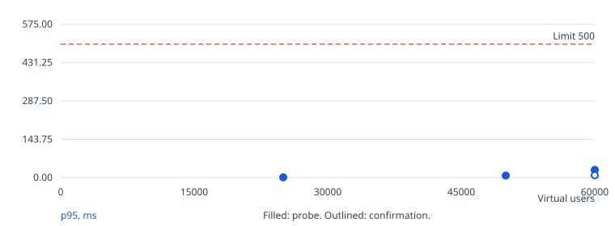
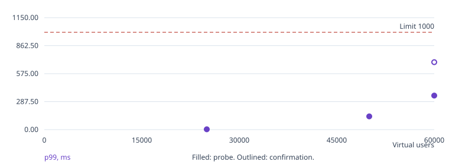
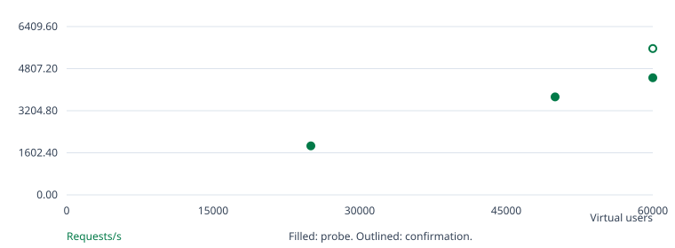
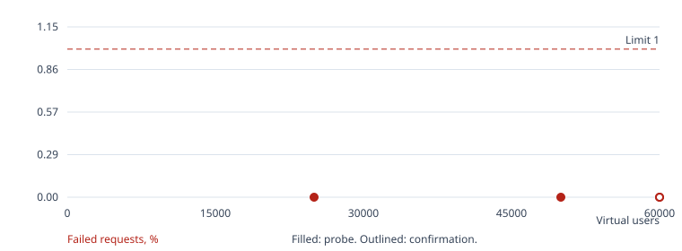

# Go / SQLite benchmark

Confirmed k8s baseline: 60,000 virtual users or more, a lower bound.

Search status: capped.

User cap reached without a failing probe; the result is a lower bound.

## Run overview

| Run | Phase | Users | Hold | Result | Requests | Req/s | p95 ms | p99 ms | Errors % | Checks |
| --- | --- | --- | --- | --- | --- | --- | --- | --- | --- | --- |
| 1 | warmup | 1000 | 120s | passed | 18259 | 83.13 | 0.51 | 0.64 | 0.000 | passed |
| 2 | search | 25000 | 60s | passed | 298818 | 1,867.08 | 0.79 | 3.69 | 0.000 | passed |
| 3 | search | 50000 | 60s | passed | 597259 | 3,730.97 | 7.70 | 135.98 | 0.000 | passed |
| 4 | search | 60000 | 60s | passed | 713852 | 4,459.11 | 28.80 | 350.08 | 0.000 | passed |
| 5 | confirm | 60000 | 300s | passed | 2229942 | 5,573.56 | 8.69 | 692.88 | 0.000 | passed |

## Run 1: warmup, 1,000 users

Outcome: passed. Exit code: 0.

Started: 2026-10-16T23:13:07+00:00. Wall time: 220.81 seconds.

| Condition | Result |
| --- | --- |
| p(95)<500 | passed |
| p(99)<1000 | passed |
| rate<0.01 | passed |
| feed 200 | passed: 8,411 passed, 0 failed |
| post 200 | passed: 8,411 passed, 0 failed |
| like 200/201 | passed: 1,265 passed, 0 failed |
| create 201 | passed: 172 passed, 0 failed |

[Console log](run-001.log)
[Raw k6 summary](k6/run-001.json)
[Structured k6 events](k6/run-001.events.jsonl)
[CPU profile (go tool pprof)](pprof/run-001.cpu.pb.gz)
[Heap profile (go tool pprof)](pprof/run-001.heap.pb.gz)

Average latency: 0.35 ms. Maximum latency: 6.50 ms.

App average CPU: 3.11% of one core. Sampled memory peak: 51.14 MiB. OOM kills: 0. Source: container cgroup CPU, memory.current including page cache, and OOM kills.

## Run 2: search, 25,000 users

Outcome: passed. Exit code: 0.

Started: 2026-10-16T23:17:50+00:00. Wall time: 163.54 seconds.

| Condition | Result |
| --- | --- |
| p(95)<500 | passed |
| p(99)<1000 | passed |
| rate<0.01 | passed |
| feed 200 | passed: 137,809 passed, 0 failed |
| post 200 | passed: 137,809 passed, 0 failed |
| like 200/201 | passed: 20,485 passed, 0 failed |
| create 201 | passed: 2,715 passed, 0 failed |

[Console log](run-002.log)
[Raw k6 summary](k6/run-002.json)
[Structured k6 events](k6/run-002.events.jsonl)
[CPU profile (go tool pprof)](pprof/run-002.cpu.pb.gz)
[Heap profile (go tool pprof)](pprof/run-002.heap.pb.gz)

Average latency: 0.42 ms. Maximum latency: 61.54 ms.

App average CPU: 26.02% of one core. Sampled memory peak: 713.43 MiB. OOM kills: 0. Source: container cgroup CPU, memory.current including page cache, and OOM kills.

## Run 3: search, 50,000 users

Outcome: passed. Exit code: 0.

Started: 2026-10-16T23:21:36+00:00. Wall time: 165.86 seconds.

| Condition | Result |
| --- | --- |
| p(95)<500 | passed |
| p(99)<1000 | passed |
| rate<0.01 | passed |
| feed 200 | passed: 275,430 passed, 0 failed |
| post 200 | passed: 275,430 passed, 0 failed |
| like 200/201 | passed: 41,015 passed, 0 failed |
| create 201 | passed: 5,384 passed, 0 failed |

[Console log](run-003.log)
[Raw k6 summary](k6/run-003.json)
[Structured k6 events](k6/run-003.events.jsonl)
[CPU profile (go tool pprof)](pprof/run-003.cpu.pb.gz)
[Heap profile (go tool pprof)](pprof/run-003.heap.pb.gz)

Average latency: 4.10 ms. Maximum latency: 429.22 ms.

App average CPU: 40.63% of one core. Sampled memory peak: 1,366.25 MiB. OOM kills: 0. Source: container cgroup CPU, memory.current including page cache, and OOM kills.

## Run 4: search, 60,000 users

Outcome: passed. Exit code: 0.

Started: 2026-10-16T23:25:25+00:00. Wall time: 166.77 seconds.

| Condition | Result |
| --- | --- |
| p(95)<500 | passed |
| p(99)<1000 | passed |
| rate<0.01 | passed |
| feed 200 | passed: 329,233 passed, 0 failed |
| post 200 | passed: 329,233 passed, 0 failed |
| like 200/201 | passed: 48,864 passed, 0 failed |
| create 201 | passed: 6,522 passed, 0 failed |

[Console log](run-004.log)
[Raw k6 summary](k6/run-004.json)
[Structured k6 events](k6/run-004.events.jsonl)
[CPU profile (go tool pprof)](pprof/run-004.cpu.pb.gz)
[Heap profile (go tool pprof)](pprof/run-004.heap.pb.gz)

Average latency: 13.51 ms. Maximum latency: 5,543.11 ms.

App average CPU: 46.11% of one core. Sampled memory peak: 1,647.59 MiB. OOM kills: 0. Source: container cgroup CPU, memory.current including page cache, and OOM kills.

## Run 5: confirm, 60,000 users

Outcome: passed. Exit code: 0.

Started: 2026-10-16T23:29:16+00:00. Wall time: 407.47 seconds.

| Condition | Result |
| --- | --- |
| p(95)<500 | passed |
| p(99)<1000 | passed |
| rate<0.01 | passed |
| feed 200 | passed: 1,028,179 passed, 0 failed |
| post 200 | passed: 1,028,179 passed, 0 failed |
| like 200/201 | passed: 153,172 passed, 0 failed |
| create 201 | passed: 20,412 passed, 0 failed |

[Console log](run-005.log)
[Raw k6 summary](k6/run-005.json)
[Structured k6 events](k6/run-005.events.jsonl)
[CPU profile (go tool pprof)](pprof/run-005.cpu.pb.gz)
[Heap profile (go tool pprof)](pprof/run-005.heap.pb.gz)

Average latency: 16.70 ms. Maximum latency: 6,205.45 ms.

App average CPU: 55.69% of one core. Sampled memory peak: 1,668.62 MiB. OOM kills: 0. Source: container cgroup CPU, memory.current including page cache, and OOM kills.

## Confirmation spread

Successful same-instance, sequential confirmations: 1. p95 range: 8.69 to 8.69 ms. This is not fresh-instance variability. A single confirmation does not measure run-to-run variability.

## Charts









## Environment and settings

```json
{
  "mode": "k8s",
  "url": "http://127.0.0.1:53089",
  "k6_url": "http://server",
  "k6": "k6 v2.2.0 (commit/00a9a1b7f5, go1.26.5, linux/amd64)",
  "app_probe": "container cgroup CPU, memory.current including page cache, and OOM kills",
  "host": "macOS-27.0.1-arm64-arm-64bit-Mach-O",
  "host_logical_cpus": 14,
  "workload_sha256": "14fbbe36a7bef2cc803c8c2309b8b93d6e6ec9c2b6aba78ebe3b9a95ebf85972",
  "settings": {
    "url": "http://127.0.0.1:53089",
    "tokens": null,
    "mode": "k8s",
    "k6": "exec",
    "k6_bin": "k6",
    "k6_exec": "kubectl --context admin@coruscant -n twelve-dollar-go exec k6 -c k6 --",
    "k6_url": "http://server",
    "docker_network": null,
    "app_pid": null,
    "app_exec": [
      "kubectl --context admin@coruscant -n twelve-dollar-go exec server -c app --"
    ],
    "app_limits": {
      "cpu": "1",
      "memory": "2Gi"
    },
    "pprof": "127.0.0.1:6060",
    "pprof_exec": "kubectl --context admin@coruscant -n twelve-dollar-go exec server -c app --",
    "output": null,
    "wait_seconds": 120,
    "warmup_vus": 1000,
    "warmup_seconds": 120,
    "start_vus": 25000,
    "max_vus": 60000,
    "step": 250,
    "probe_seconds": 60,
    "confirm_seconds": 300,
    "confirm_runs": 1,
    "ramp_seconds": 60,
    "budget_seconds": 3600
  },
  "app_limits": {
    "cpu": "1",
    "memory": "2Gi"
  }
}
```

## Interpretation

- K8s-mode benchmark, not an official challenge score. Results describe this machine and deployment.
- Latency and throughput include ramp-up, hold, ramp-down, and graceful completion. Charts exclude warm-up.
- Chart points are not joined: probes and confirmations have different hold durations. Outlined points are confirmations.
- The warm-up run exercises the running app before the search and is excluded from the score. Writes accumulate across runs.
- Benchmark status uses the challenge thresholds. Endpoint check failures are reported separately; unexercised checks are not passes.
- App CPU is the average over each run's sampling window. Memory peak is the highest sample, taken every 2 seconds.
