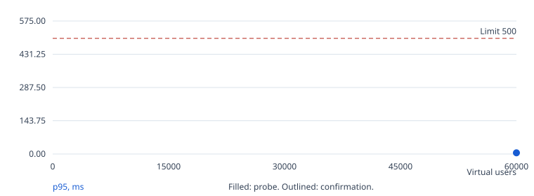
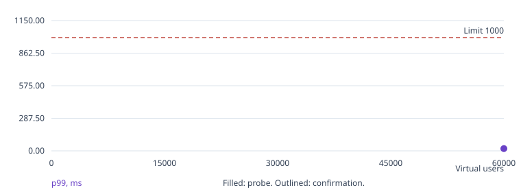
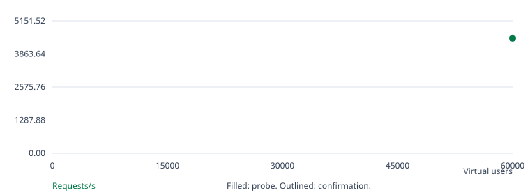
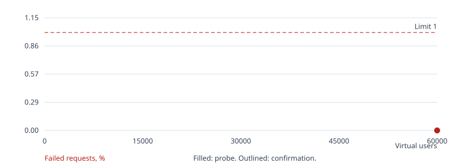

# Go / SQLite benchmark

No confirmed result.

Search status: execution error.

k6 was killed (exit 137), usually because it ran out of memory. Give k6 more memory (in Docker mode, BENCH_K6=local) or lower BENCH_MAX_VUS.

## Run overview

| Run | Phase | Users | Hold | Result | Requests | Req/s | p95 ms | p99 ms | Errors % | Checks |
| --- | --- | --- | --- | --- | --- | --- | --- | --- | --- | --- |
| 1 | warmup | 1000 | 120s | passed | 18281 | 83.09 | 0.51 | 0.64 | 0.000 | passed |
| 2 | search | 60000 | 60s | passed | 717360 | 4,479.59 | 5.19 | 20.19 | 0.000 | passed |
| 3 | search | 80000 | 60s | execution error | n/a | n/a | n/a | n/a | n/a | not available |

## Run 1: warmup, 1,000 users

Outcome: passed. Exit code: 0.

Started: 2026-10-17T00:07:34+00:00. Wall time: 221.11 seconds.

| Condition | Result |
| --- | --- |
| p(95)<500 | passed |
| p(99)<1000 | passed |
| rate<0.01 | passed |
| feed 200 | passed: 8,422 passed, 0 failed |
| post 200 | passed: 8,422 passed, 0 failed |
| like 200/201 | passed: 1,267 passed, 0 failed |
| create 201 | passed: 170 passed, 0 failed |

[Console log](run-001.log)
[Raw k6 summary](k6/run-001.json)
[Structured k6 events](k6/run-001.events.jsonl)
[CPU profile (go tool pprof)](pprof/run-001.cpu.pb.gz)
[Heap profile (go tool pprof)](pprof/run-001.heap.pb.gz)

Average latency: 0.35 ms. Maximum latency: 20.74 ms.

App average CPU: 3.11% of one core. Sampled memory peak: 56.58 MiB. OOM kills: 0. Source: container cgroup CPU, memory.current including page cache, and OOM kills.

## Run 2: search, 60,000 users

Outcome: passed. Exit code: 0.

Started: 2026-10-17T00:12:17+00:00. Wall time: 166.64 seconds.

| Condition | Result |
| --- | --- |
| p(95)<500 | passed |
| p(99)<1000 | passed |
| rate<0.01 | passed |
| feed 200 | passed: 330,758 passed, 0 failed |
| post 200 | passed: 330,758 passed, 0 failed |
| like 200/201 | passed: 49,349 passed, 0 failed |
| create 201 | passed: 6,495 passed, 0 failed |

[Console log](run-002.log)
[Raw k6 summary](k6/run-002.json)
[Structured k6 events](k6/run-002.events.jsonl)
[CPU profile (go tool pprof)](pprof/run-002.cpu.pb.gz)
[Heap profile (go tool pprof)](pprof/run-002.heap.pb.gz)

Average latency: 1.32 ms. Maximum latency: 285.88 ms.

App average CPU: 45.98% of one core. Sampled memory peak: 1,573.40 MiB. OOM kills: 0. Source: container cgroup CPU, memory.current including page cache, and OOM kills.

## Run 3: search, 80,000 users

Outcome: execution error. Exit code: 137.

Started: 2026-10-17T00:16:07+00:00. Wall time: 135.86 seconds.

| Condition | Result |
| --- | --- |

[Console log](run-003.log)
[CPU profile (go tool pprof)](pprof/run-003.cpu.pb.gz)
[Heap profile (go tool pprof)](pprof/run-003.heap.pb.gz)

Error: k6 was killed (exit 137), usually because it ran out of memory. Give k6 more memory (in Docker mode, BENCH_K6=local) or lower BENCH_MAX_VUS.

## Charts









## Environment and settings

```json
{
  "mode": "k8s",
  "url": "http://127.0.0.1:61069",
  "k6_url": "http://server",
  "k6": "k6 v2.2.0 (commit/00a9a1b7f5, go1.26.5, linux/amd64)",
  "app_probe": "container cgroup CPU, memory.current including page cache, and OOM kills",
  "host": "macOS-27.0.1-arm64-arm-64bit-Mach-O",
  "host_logical_cpus": 14,
  "workload_sha256": "14fbbe36a7bef2cc803c8c2309b8b93d6e6ec9c2b6aba78ebe3b9a95ebf85972",
  "settings": {
    "url": "http://127.0.0.1:61069",
    "tokens": null,
    "mode": "k8s",
    "k6": "exec",
    "k6_bin": "k6",
    "k6_exec": "kubectl --context admin@coruscant -n twelve-dollar-go exec k6 -c k6 --",
    "k6_url": "http://server",
    "docker_network": null,
    "app_pid": null,
    "app_exec": [
      "kubectl --context admin@coruscant -n twelve-dollar-go exec server -c app --"
    ],
    "app_limits": {
      "cpu": "1",
      "memory": "2Gi"
    },
    "pprof": "127.0.0.1:6060",
    "pprof_exec": "kubectl --context admin@coruscant -n twelve-dollar-go exec server -c app --",
    "output": null,
    "wait_seconds": 120,
    "warmup_vus": 1000,
    "warmup_seconds": 120,
    "start_vus": 60000,
    "max_vus": 80000,
    "step": 250,
    "probe_seconds": 60,
    "confirm_seconds": 300,
    "confirm_runs": 1,
    "ramp_seconds": 60,
    "budget_seconds": 3600
  },
  "app_limits": {
    "cpu": "1",
    "memory": "2Gi"
  }
}
```

## Interpretation

- K8s-mode benchmark, not an official challenge score. Results describe this machine and deployment.
- Latency and throughput include ramp-up, hold, ramp-down, and graceful completion. Charts exclude warm-up.
- Chart points are not joined: probes and confirmations have different hold durations. Outlined points are confirmations.
- The warm-up run exercises the running app before the search and is excluded from the score. Writes accumulate across runs.
- Benchmark status uses the challenge thresholds. Endpoint check failures are reported separately; unexercised checks are not passes.
- App CPU is the average over each run's sampling window. Memory peak is the highest sample, taken every 2 seconds.
