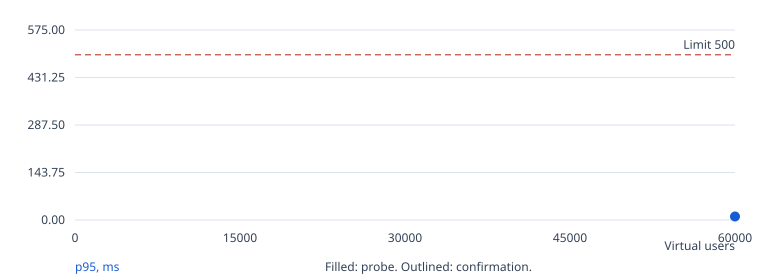
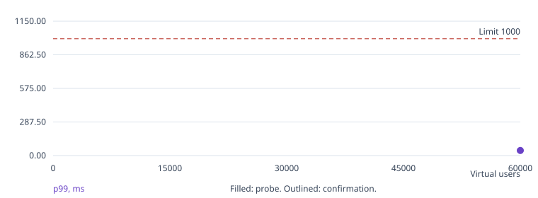
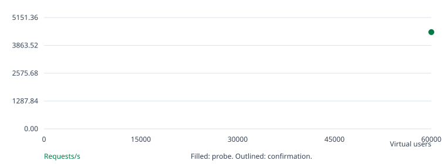
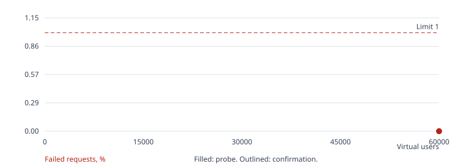

# Go / SQLite benchmark

No confirmed result.

Search status: execution error.

k6 was killed (exit 137), usually because it ran out of memory. Give k6 more memory (BENCH_K6=local in Docker mode; K8S_K6_MEMORY or K8S_K6_PODS in k8s mode) or lower BENCH_MAX_VUS.

## Run overview

| Run | Phase | Users | Hold | Result | Requests | Req/s | p95 ms | p99 ms | Errors % | Checks |
| --- | --- | --- | --- | --- | --- | --- | --- | --- | --- | --- |
| 1 | warmup | 1000 | 120s | passed | 18234 | 82.91 | 0.90 | 1.37 | 0.000 | passed |
| 2 | search | 60000 | 60s | passed | 716921 | 4,479.44 | 10.52 | 43.81 | 0.000 | passed |
| 3 | search | 80000 | 60s | execution error | n/a | n/a | n/a | n/a | n/a | not available |

## Run 1: warmup, 1,000 users

Outcome: passed. Exit code: [0, 0].

Started: 2026-10-17T13:25:02+00:00. Wall time: 220.93 seconds.

| Condition | Result |
| --- | --- |
| p(95)<500 | passed |
| p(99)<1000 | passed |
| rate<0.01 | passed |
| feed 200 | passed: 8,421 passed, 0 failed |
| post 200 | passed: 8,421 passed, 0 failed |
| like 200/201 | passed: 1,228 passed, 0 failed |
| create 201 | passed: 164 passed, 0 failed |

[Console log](run-001.log)
[Raw k6 summary, k6 0](k6/run-001.instance-0.json)
[Raw k6 summary, k6 1](k6/run-001.instance-1.json)
[Structured k6 events, k6 0](k6/run-001.instance-0.events.jsonl)
[Structured k6 events, k6 1](k6/run-001.instance-1.events.jsonl)
[CPU profile (go tool pprof)](pprof/run-001.cpu.pb.gz)
[Heap profile (go tool pprof)](pprof/run-001.heap.pb.gz)

Average latency: 0.62 ms. Maximum latency: 21.05 ms.

App average CPU: 3.51% of one core. Sampled memory peak: 68.39 MiB. OOM kills: 0. Source: container cgroup CPU, memory.current including page cache, and OOM kills.

## Run 2: search, 60,000 users

Outcome: passed. Exit code: [0, 0].

Started: 2026-10-17T13:29:44+00:00. Wall time: 167.39 seconds.

| Condition | Result |
| --- | --- |
| p(95)<500 | passed |
| p(99)<1000 | passed |
| rate<0.01 | passed |
| feed 200 | passed: 330,604 passed, 0 failed |
| post 200 | passed: 330,604 passed, 0 failed |
| like 200/201 | passed: 49,175 passed, 0 failed |
| create 201 | passed: 6,538 passed, 0 failed |

[Console log](run-002.log)
[Raw k6 summary, k6 0](k6/run-002.instance-0.json)
[Raw k6 summary, k6 1](k6/run-002.instance-1.json)
[Structured k6 events, k6 0](k6/run-002.instance-0.events.jsonl)
[Structured k6 events, k6 1](k6/run-002.instance-1.events.jsonl)
[CPU profile (go tool pprof)](pprof/run-002.cpu.pb.gz)
[Heap profile (go tool pprof)](pprof/run-002.heap.pb.gz)

Average latency: 2.76 ms. Maximum latency: 463.88 ms.

App average CPU: 66.31% of one core. Sampled memory peak: 1,601.00 MiB. OOM kills: 0. Source: container cgroup CPU, memory.current including page cache, and OOM kills.

## Run 3: search, 80,000 users

Outcome: execution error. Exit code: [0, 137].

Started: 2026-10-17T13:33:34+00:00. Wall time: 165.03 seconds.

| Condition | Result |
| --- | --- |

[Console log](run-003.log)
[CPU profile (go tool pprof)](pprof/run-003.cpu.pb.gz)
[Heap profile (go tool pprof)](pprof/run-003.heap.pb.gz)

Error: k6 was killed (exit 137), usually because it ran out of memory. Give k6 more memory (BENCH_K6=local in Docker mode; K8S_K6_MEMORY or K8S_K6_PODS in k8s mode) or lower BENCH_MAX_VUS.

## Charts









## Environment and settings

```json
{
  "mode": "k8s",
  "url": "http://127.0.0.1:63496",
  "k6_url": "http://server",
  "k6": "k6 v2.2.0 (commit/00a9a1b7f5, go1.26.5, linux/amd64)",
  "k6_instances": 2,
  "app_probe": "container cgroup CPU, memory.current including page cache, and OOM kills",
  "host": "macOS-27.0.1-arm64-arm-64bit-Mach-O",
  "host_logical_cpus": 14,
  "workload_sha256": "14fbbe36a7bef2cc803c8c2309b8b93d6e6ec9c2b6aba78ebe3b9a95ebf85972",
  "settings": {
    "url": "http://127.0.0.1:63496",
    "tokens": null,
    "mode": "k8s",
    "k6": "exec",
    "k6_bin": "k6",
    "k6_exec": [
      "kubectl --context admin@coruscant -n twelve-dollar-go exec k6-0 -c k6 --",
      "kubectl --context admin@coruscant -n twelve-dollar-go exec k6-1 -c k6 --"
    ],
    "k6_url": "http://server",
    "docker_network": null,
    "app_pid": null,
    "app_exec": [
      "kubectl --context admin@coruscant -n twelve-dollar-go exec server -c app --"
    ],
    "app_limits": {
      "cpu": "1",
      "memory": "2Gi"
    },
    "pprof": "127.0.0.1:6060",
    "pprof_exec": "kubectl --context admin@coruscant -n twelve-dollar-go exec server -c app --",
    "output": null,
    "wait_seconds": 120,
    "warmup_vus": 1000,
    "warmup_seconds": 120,
    "start_vus": 60000,
    "max_vus": 80000,
    "step": 250,
    "probe_seconds": 60,
    "confirm_seconds": 300,
    "confirm_runs": 1,
    "ramp_seconds": 60,
    "budget_seconds": 7200
  },
  "app_limits": {
    "cpu": "1",
    "memory": "2Gi"
  }
}
```

## Interpretation

- K8s-mode benchmark, not an official challenge score. Results describe this machine and deployment.
- Latency and throughput include ramp-up, hold, ramp-down, and graceful completion. Charts exclude warm-up.
- Chart points are not joined: probes and confirmations have different hold durations. Outlined points are confirmations.
- The warm-up run exercises the running app before the search and is excluded from the score. Writes accumulate across runs.
- Benchmark status uses the challenge thresholds. Endpoint check failures are reported separately; unexercised checks are not passes.
- App CPU is the average over each run's sampling window. Memory peak is the highest sample, taken every 2 seconds.
- 2 k6 processes each ran an equal share of the users. Requests, errors, and checks are totals. p95 and p99 are the highest process's value, an upper bound of the whole run's, so a run passes only if every process met the latency thresholds.
