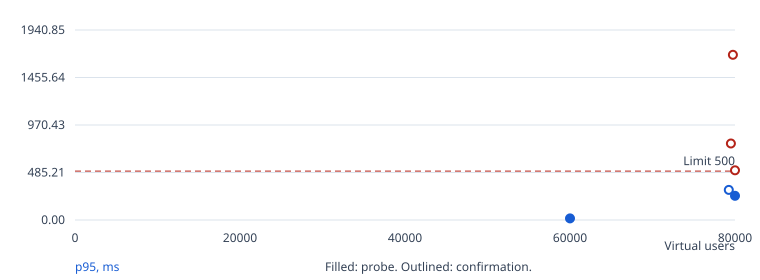
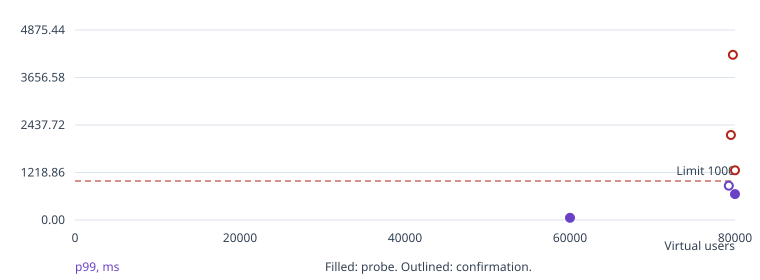
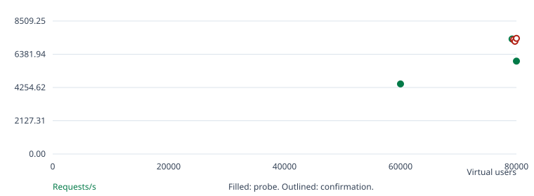
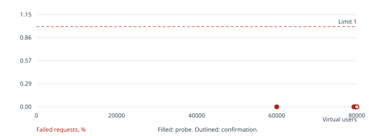

# Go / SQLite benchmark

Confirmed k8s baseline: 79,250 virtual users.

Search status: completed.

Search and confirmation finished.

## Run overview

| Run | Phase | Users | Hold | Result | Requests | Req/s | p95 ms | p99 ms | Errors % | Checks |
| --- | --- | --- | --- | --- | --- | --- | --- | --- | --- | --- |
| 1 | warmup | 1000 | 120s | passed | 18263 | 83.02 | 0.92 | 1.58 | 0.000 | passed |
| 2 | search | 60000 | 60s | passed | 717378 | 4,482.75 | 16.82 | 56.78 | 0.000 | passed |
| 3 | search | 80000 | 60s | passed | 951439 | 5,944.81 | 247.55 | 664.70 | 0.000 | passed |
| 4 | confirm | 80000 | 300s | threshold failed | 2960091 | 7,399.35 | 507.44 | 1,276.33 | 0.000 | passed |
| 5 | confirm | 79750 | 300s | threshold failed | 2884643 | 7,210.75 | 1,687.70 | 4,239.51 | 0.000 | passed |
| 6 | confirm | 79500 | 300s | threshold failed | 2927883 | 7,318.91 | 781.34 | 2,181.81 | 0.000 | passed |
| 7 | confirm | 79250 | 300s | passed | 2943753 | 7,358.60 | 307.18 | 880.09 | 0.000 | passed |

## Run 1: warmup, 1,000 users

Outcome: passed. Exit code: [0, 0, 0].

Started: 2026-10-17T14:34:57+00:00. Wall time: 221.19 seconds.

| Condition | Result |
| --- | --- |
| p(95)<500 | passed |
| p(99)<1000 | passed |
| rate<0.01 | passed |
| feed 200 | passed: 8,437 passed, 0 failed |
| post 200 | passed: 8,437 passed, 0 failed |
| like 200/201 | passed: 1,242 passed, 0 failed |
| create 201 | passed: 147 passed, 0 failed |

[Console log](run-001.log)
[Raw k6 summary, k6 0](k6/run-001.instance-0.json)
[Raw k6 summary, k6 1](k6/run-001.instance-1.json)
[Raw k6 summary, k6 2](k6/run-001.instance-2.json)
[Structured k6 events, k6 0](k6/run-001.instance-0.events.jsonl)
[Structured k6 events, k6 1](k6/run-001.instance-1.events.jsonl)
[Structured k6 events, k6 2](k6/run-001.instance-2.events.jsonl)
[CPU profile (go tool pprof)](pprof/run-001.cpu.pb.gz)
[Heap profile (go tool pprof)](pprof/run-001.heap.pb.gz)

Average latency: 0.63 ms. Maximum latency: 12.06 ms.

App average CPU: 3.65% of one core. Sampled memory peak: 50.86 MiB. OOM kills: 0. Source: container cgroup CPU, memory.current including page cache, and OOM kills.

## Run 2: search, 60,000 users

Outcome: passed. Exit code: [0, 0, 0].

Started: 2026-10-17T14:39:41+00:00. Wall time: 165.04 seconds.

| Condition | Result |
| --- | --- |
| p(95)<500 | passed |
| p(99)<1000 | passed |
| rate<0.01 | passed |
| feed 200 | passed: 330,769 passed, 0 failed |
| post 200 | passed: 330,769 passed, 0 failed |
| like 200/201 | passed: 49,276 passed, 0 failed |
| create 201 | passed: 6,564 passed, 0 failed |

[Console log](run-002.log)
[Raw k6 summary, k6 0](k6/run-002.instance-0.json)
[Raw k6 summary, k6 1](k6/run-002.instance-1.json)
[Raw k6 summary, k6 2](k6/run-002.instance-2.json)
[Structured k6 events, k6 0](k6/run-002.instance-0.events.jsonl)
[Structured k6 events, k6 1](k6/run-002.instance-1.events.jsonl)
[Structured k6 events, k6 2](k6/run-002.instance-2.events.jsonl)
[CPU profile (go tool pprof)](pprof/run-002.cpu.pb.gz)
[Heap profile (go tool pprof)](pprof/run-002.heap.pb.gz)

Average latency: 3.38 ms. Maximum latency: 284.75 ms.

App average CPU: 69.80% of one core. Sampled memory peak: 1,593.18 MiB. OOM kills: 0. Source: container cgroup CPU, memory.current including page cache, and OOM kills.

## Run 3: search, 80,000 users

Outcome: passed. Exit code: [0, 0, 0].

Started: 2026-10-17T14:43:28+00:00. Wall time: 166.50 seconds.

| Condition | Result |
| --- | --- |
| p(95)<500 | passed |
| p(99)<1000 | passed |
| rate<0.01 | passed |
| feed 200 | passed: 438,832 passed, 0 failed |
| post 200 | passed: 438,832 passed, 0 failed |
| like 200/201 | passed: 65,096 passed, 0 failed |
| create 201 | passed: 8,679 passed, 0 failed |

[Console log](run-003.log)
[Raw k6 summary, k6 0](k6/run-003.instance-0.json)
[Raw k6 summary, k6 1](k6/run-003.instance-1.json)
[Raw k6 summary, k6 2](k6/run-003.instance-2.json)
[Structured k6 events, k6 0](k6/run-003.instance-0.events.jsonl)
[Structured k6 events, k6 1](k6/run-003.instance-1.events.jsonl)
[Structured k6 events, k6 2](k6/run-003.instance-2.events.jsonl)
[CPU profile (go tool pprof)](pprof/run-003.cpu.pb.gz)
[Heap profile (go tool pprof)](pprof/run-003.heap.pb.gz)

Average latency: 44.67 ms. Maximum latency: 3,280.59 ms.

App average CPU: 78.98% of one core. Sampled memory peak: 1,831.52 MiB. OOM kills: 0. Source: container cgroup CPU, memory.current including page cache, and OOM kills.

## Run 4: confirm, 80,000 users

Outcome: threshold failed. Exit code: [99, 99, 99].

Started: 2026-10-17T14:47:18+00:00. Wall time: 406.70 seconds.

| Condition | Result |
| --- | --- |
| p(95)<500 | failed |
| p(99)<1000 | failed |
| rate<0.01 | passed |
| feed 200 | passed: 1,364,249 passed, 0 failed |
| post 200 | passed: 1,364,249 passed, 0 failed |
| like 200/201 | passed: 204,360 passed, 0 failed |
| create 201 | passed: 27,233 passed, 0 failed |

[Console log](run-004.log)
[Raw k6 summary, k6 0](k6/run-004.instance-0.json)
[Raw k6 summary, k6 1](k6/run-004.instance-1.json)
[Raw k6 summary, k6 2](k6/run-004.instance-2.json)
[Structured k6 events, k6 0](k6/run-004.instance-0.events.jsonl)
[Structured k6 events, k6 1](k6/run-004.instance-1.events.jsonl)
[Structured k6 events, k6 2](k6/run-004.instance-2.events.jsonl)
[CPU profile (go tool pprof)](pprof/run-004.cpu.pb.gz)
[Heap profile (go tool pprof)](pprof/run-004.heap.pb.gz)

Average latency: 93.29 ms. Maximum latency: 5,615.44 ms.

App average CPU: 90.96% of one core. Sampled memory peak: 1,847.31 MiB. OOM kills: 0. Source: container cgroup CPU, memory.current including page cache, and OOM kills.

## Run 5: confirm, 79,750 users

Outcome: threshold failed. Exit code: [99, 99, 99].

Started: 2026-10-17T14:55:07+00:00. Wall time: 406.68 seconds.

| Condition | Result |
| --- | --- |
| p(95)<500 | failed |
| p(99)<1000 | failed |
| rate<0.01 | passed |
| feed 200 | passed: 1,329,708 passed, 0 failed |
| post 200 | passed: 1,329,708 passed, 0 failed |
| like 200/201 | passed: 198,873 passed, 0 failed |
| create 201 | passed: 26,354 passed, 0 failed |

[Console log](run-005.log)
[Raw k6 summary, k6 0](k6/run-005.instance-0.json)
[Raw k6 summary, k6 1](k6/run-005.instance-1.json)
[Raw k6 summary, k6 2](k6/run-005.instance-2.json)
[Structured k6 events, k6 0](k6/run-005.instance-0.events.jsonl)
[Structured k6 events, k6 1](k6/run-005.instance-1.events.jsonl)
[Structured k6 events, k6 2](k6/run-005.instance-2.events.jsonl)
[CPU profile (go tool pprof)](pprof/run-005.cpu.pb.gz)
[Heap profile (go tool pprof)](pprof/run-005.heap.pb.gz)

Average latency: 313.22 ms. Maximum latency: 23,020.06 ms.

App average CPU: 90.85% of one core. Sampled memory peak: 1,865.59 MiB. OOM kills: 0. Source: container cgroup CPU, memory.current including page cache, and OOM kills.

## Run 6: confirm, 79,500 users

Outcome: threshold failed. Exit code: [99, 99, 99].

Started: 2026-10-17T15:02:57+00:00. Wall time: 406.49 seconds.

| Condition | Result |
| --- | --- |
| p(95)<500 | failed |
| p(99)<1000 | failed |
| rate<0.01 | passed |
| feed 200 | passed: 1,349,453 passed, 0 failed |
| post 200 | passed: 1,349,452 passed, 0 failed |
| like 200/201 | passed: 202,266 passed, 0 failed |
| create 201 | passed: 26,712 passed, 0 failed |

[Console log](run-006.log)
[Raw k6 summary, k6 0](k6/run-006.instance-0.json)
[Raw k6 summary, k6 1](k6/run-006.instance-1.json)
[Raw k6 summary, k6 2](k6/run-006.instance-2.json)
[Structured k6 events, k6 0](k6/run-006.instance-0.events.jsonl)
[Structured k6 events, k6 1](k6/run-006.instance-1.events.jsonl)
[Structured k6 events, k6 2](k6/run-006.instance-2.events.jsonl)
[CPU profile (go tool pprof)](pprof/run-006.cpu.pb.gz)
[Heap profile (go tool pprof)](pprof/run-006.heap.pb.gz)

Average latency: 145.54 ms. Maximum latency: 10,711.93 ms.

App average CPU: 90.99% of one core. Sampled memory peak: 1,877.49 MiB. OOM kills: 0. Source: container cgroup CPU, memory.current including page cache, and OOM kills.

## Run 7: confirm, 79,250 users

Outcome: passed. Exit code: [0, 0, 0].

Started: 2026-10-17T15:10:46+00:00. Wall time: 406.38 seconds.

| Condition | Result |
| --- | --- |
| p(95)<500 | passed |
| p(99)<1000 | passed |
| rate<0.01 | passed |
| feed 200 | passed: 1,356,910 passed, 0 failed |
| post 200 | passed: 1,356,910 passed, 0 failed |
| like 200/201 | passed: 202,826 passed, 0 failed |
| create 201 | passed: 27,107 passed, 0 failed |

[Console log](run-007.log)
[Raw k6 summary, k6 0](k6/run-007.instance-0.json)
[Raw k6 summary, k6 1](k6/run-007.instance-1.json)
[Raw k6 summary, k6 2](k6/run-007.instance-2.json)
[Structured k6 events, k6 0](k6/run-007.instance-0.events.jsonl)
[Structured k6 events, k6 1](k6/run-007.instance-1.events.jsonl)
[Structured k6 events, k6 2](k6/run-007.instance-2.events.jsonl)
[CPU profile (go tool pprof)](pprof/run-007.cpu.pb.gz)
[Heap profile (go tool pprof)](pprof/run-007.heap.pb.gz)

Average latency: 52.62 ms. Maximum latency: 4,260.31 ms.

App average CPU: 90.52% of one core. Sampled memory peak: 1,883.12 MiB. OOM kills: 0. Source: container cgroup CPU, memory.current including page cache, and OOM kills.

## Confirmation spread

Successful same-instance, sequential confirmations: 1. p95 range: 307.18 to 307.18 ms. This is not fresh-instance variability. A single confirmation does not measure run-to-run variability.

## Charts









## Environment and settings

```json
{
  "mode": "k8s",
  "url": "http://127.0.0.1:54625",
  "k6_url": "http://server",
  "k6": "k6 v2.2.0 (commit/00a9a1b7f5, go1.26.5, linux/amd64)",
  "k6_instances": 3,
  "app_probe": "container cgroup CPU, memory.current including page cache, and OOM kills",
  "host": "macOS-27.0.1-arm64-arm-64bit-Mach-O",
  "host_logical_cpus": 14,
  "workload_sha256": "14fbbe36a7bef2cc803c8c2309b8b93d6e6ec9c2b6aba78ebe3b9a95ebf85972",
  "settings": {
    "url": "http://127.0.0.1:54625",
    "tokens": null,
    "mode": "k8s",
    "k6": "exec",
    "k6_bin": "k6",
    "k6_exec": [
      "kubectl --context admin@coruscant -n twelve-dollar-go exec k6-0 -c k6 --",
      "kubectl --context admin@coruscant -n twelve-dollar-go exec k6-1 -c k6 --",
      "kubectl --context admin@coruscant -n twelve-dollar-go exec k6-2 -c k6 --"
    ],
    "k6_url": "http://server",
    "docker_network": null,
    "app_pid": null,
    "app_exec": [
      "kubectl --context admin@coruscant -n twelve-dollar-go exec server -c app --"
    ],
    "app_limits": {
      "cpu": "1",
      "memory": "2Gi"
    },
    "pprof": "127.0.0.1:6060",
    "pprof_exec": "kubectl --context admin@coruscant -n twelve-dollar-go exec server -c app --",
    "output": null,
    "wait_seconds": 120,
    "warmup_vus": 1000,
    "warmup_seconds": 120,
    "start_vus": 60000,
    "max_vus": 80000,
    "step": 250,
    "probe_seconds": 60,
    "confirm_seconds": 300,
    "confirm_runs": 1,
    "ramp_seconds": 60,
    "budget_seconds": 7200
  },
  "app_limits": {
    "cpu": "1",
    "memory": "2Gi"
  }
}
```

## Interpretation

- K8s-mode benchmark, not an official challenge score. Results describe this machine and deployment.
- Latency and throughput include ramp-up, hold, ramp-down, and graceful completion. Charts exclude warm-up.
- Chart points are not joined: probes and confirmations have different hold durations. Outlined points are confirmations.
- The warm-up run exercises the running app before the search and is excluded from the score. Writes accumulate across runs.
- Benchmark status uses the challenge thresholds. Endpoint check failures are reported separately; unexercised checks are not passes.
- App CPU is the average over each run's sampling window. Memory peak is the highest sample, taken every 2 seconds.
- 3 k6 processes each ran an equal share of the users. Requests, errors, and checks are totals. p95 and p99 are the highest process's value, an upper bound of the whole run's, so a run passes only if every process met the latency thresholds.
